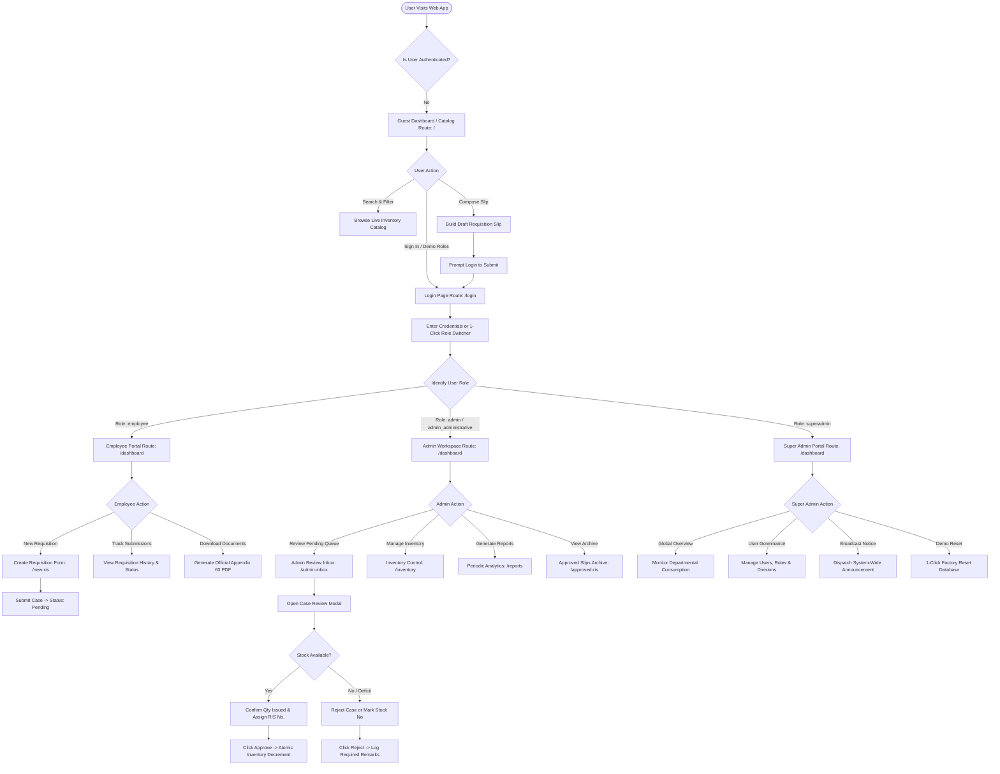
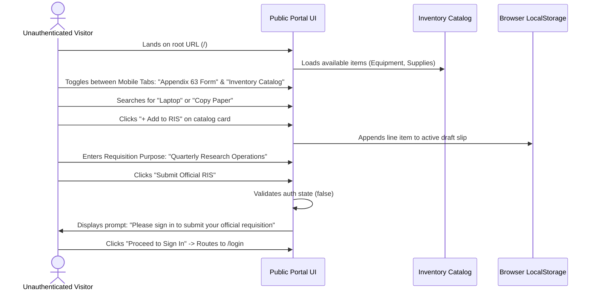
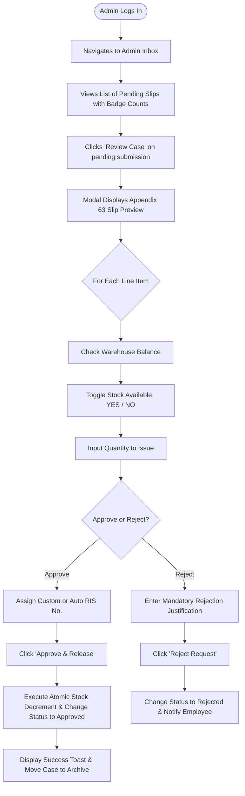
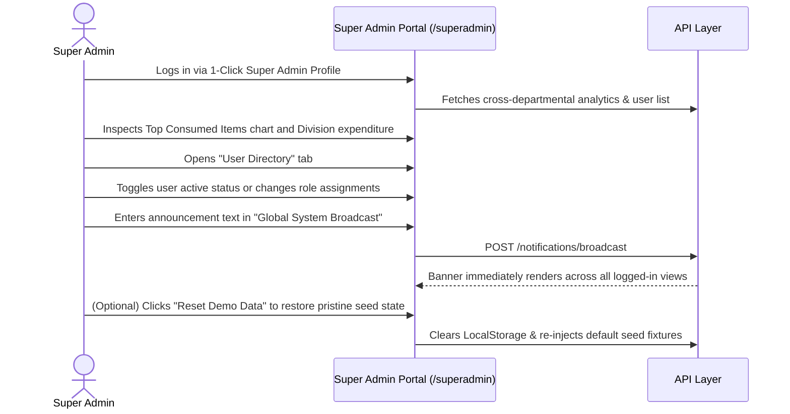
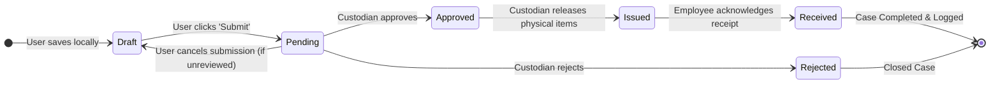

# Application Flow & User Journeys (APP FLOW)
## Requisition and Issue Slip (RIS) & Inventory Management Portal

**Document Version:** 1.2.0  
**Target Audience:** UX Designers, Product Managers, Frontend Engineers, QA Engineers  
**Classification:** System Navigation & Behavioral Flow Architecture  
**Last Updated:** October 2026  

---

## 1. Master System Flow Diagram

The diagram below maps all four user personas across the application's routes, decision gateways, action states, and document outputs:



---

## 2. Route Navigation & Access Guard Tree

The portal enforces a clean hierarchical routing model governed by the `ProtectedRoute` component:

```
/ (Root)
│
├── / (GuestDashboard)                    [Public Access]
│   ├── Catalog Browser Panel
│   └── Appendix 63 Draft Builder
│
├── /login (AuthPage)                     [Public / Redirects to /dashboard if logged in]
│   ├── Interactive Credentials Form
│   ├── 1-Click Persona Fast-Login Buttons
│   └── Factory Data Reset Trigger
│
└── [Protected Routes]                    [Requires Valid User Session]
    │
    ├── /dashboard                        [Universal Route -> Dynamic Page Rendering]
    │   ├── Role === 'employee'           ──> EmployeeRISPage
    │   ├── Role === 'admin'              ──> AdminDashboard
    │   └── Role === 'superadmin'         ──> SuperAdminPage
    │
    ├── /new-ris                          [All Authenticated Roles]
    │   └── GuestDashboard (Authenticated Mode with Pre-populated User Metadata)
    │
    ├── /admin-inbox                      [Guarded: 'admin', 'admin_administrative']
    │   └── AdminInboxPage (Case Review Queue, Stock Inspection Modal)
    │
    ├── /inventory                        [Guarded: 'admin', 'admin_administrative', 'superadmin']
    │   └── InventoryPage (Stock Management, Restock, Batch Import Simulation)
    │
    ├── /reports                          [Guarded: 'admin', 'admin_administrative', 'superadmin']
    │   └── ReportsPage (Monthly, Quarterly, Semestral, Annual Analytics)
    │
    ├── /approved-ris                     [Guarded: 'admin', 'admin_administrative', 'superadmin']
    │   └── ApprovedRISPage (Searchable Archive of Authorized Slips)
    │
    └── /superadmin                       [Guarded: 'superadmin']
        └── SuperAdminPage (User Directory, System Audits & Global Alerts)
```

---

## 3. Detailed User Journeys

### 3.1 User Journey 1: Guest / Unauthenticated Visitor
**Goal:** Explore organizational supply availability and draft a requisition before signing in.



---

### 3.2 User Journey 2: Employee / Requester (`emp1`, `emp2`)
**Goal:** Submit a requisition slip with multi-line items, monitor approval progress, and download official PDF.

```mermaid
sequenceDiagram
    actor Emp as Employee (Citizen A)
    participant UI as Employee Portal (/dashboard & /new-ris)
    participant API as API Layer
    participant PDF as jsPDF Generator

    Emp->>UI: Logs in via 1-Click Employee button
    UI->>UI: Auto-loads profile: Division, Office, Fund Cluster, Responsibility Center
    Emp->>UI: Navigates to "New Requisition"
    Emp->>UI: Types item description; autocomplete suggests matching inventory
    Emp->>UI: Specifies quantity = 5 (Live check verifies stock: 14 available)
    Emp->>UI: Clicks "Submit Requisition"
    UI->>API: POST /ris-requests (Status: 'pending')
    API-->>UI: Returns 201 Created -> Dispatches green toast notification
    UI->>Emp: Redirects to Personal Tracker Dashboard
    
    Note over Emp,UI: Later, after Custodian Approval...
    Emp->>UI: Views status badge updated to "Approved" with assigned RIS No.
    Emp->>UI: Clicks "Download Appendix 63 PDF"
    UI->>PDF: generateRISPDF(caseData)
    PDF-->>Emp: Initiates browser download of signed vector PDF document
```

---

### 3.3 User Journey 3: Admin Custodian / Supply Officer (`admin`)
**Goal:** Inspect pending requests, verify physical warehouse availability, assign official numbering, approve/reject, and adjust inventory balances.



---

### 3.4 User Journey 4: Super Admin / System Director (`superadmin`)
**Goal:** High-level departmental consumption governance, user account management, and system resets.



---

## 4. Edge Cases, Exception Handling & Validation Rules

| Scenario / Edge Case | System Behavior / Validation Gate | User Recovery Guidance |
| :--- | :--- | :--- |
| **Requested Quantity > Warehouse Stock** | Real-time warning badge displays in line item (`Only X units available`). | Requisitioner is advised to decrease quantity or custodian marks `Stock Available: NO`. |
| **Submission with Zero Line Items** | "Submit Requisition" button is disabled; clicking triggers error toast. | Toast notification: *"Please add at least one line item before submitting."* |
| **Submission with Missing Purpose** | Form validation marks the Purpose textarea in red outline. | Toast notification: *"Please specify the official purpose for this requisition."* |
| **Rejection Without Stated Reason** | "Reject" button inside custodian modal is disabled until remarks are entered. | Placeholder prompt: *"Provide a justification for the requester (e.g. out of stock, budget limit)."* |
| **Unauthenticated User Submitting Draft** | Draft is preserved in memory/localStorage while redirecting to `/login`. | Upon authentication, draft is automatically recovered and populated. |
| **Mobile / Small Screen Viewports** | Top header & sign-in button conditionally hidden on laptop/tablet per responsive design spec, while sticky segmented tab controls allow smooth toggling on phones. | User experiences zero horizontal content clipping; touch-friendly 44px+ hit targets. |

---

## 5. Requisition State Machine Specification


