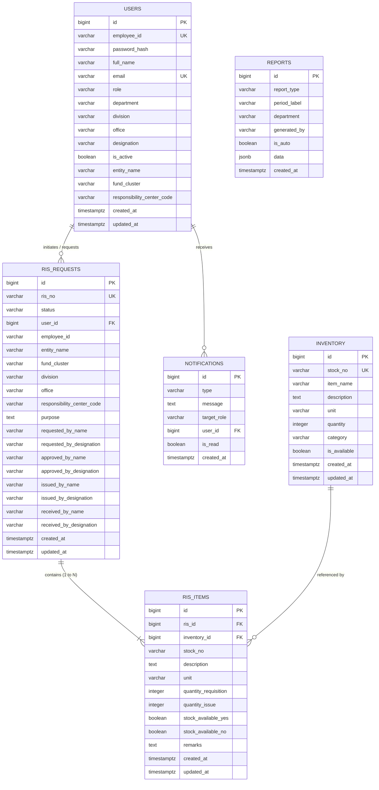
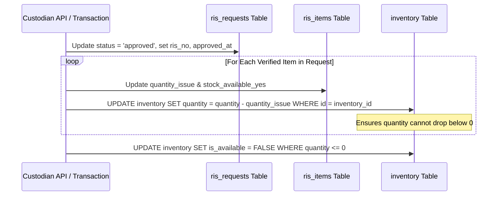

# Background Schema & Data Architecture (BACKGROUND SCHEMA)
## Requisition and Issue Slip (RIS) & Inventory Management Portal

**Document Version:** 1.2.0  
**Target Engines:** PostgreSQL 15+ / Supabase & Browser LocalStorage Client Engine  
**Classification:** Database Architecture & Data Dictionary Specification  
**Last Updated:** October 2026  

---

## 1. Entity-Relationship Diagram (ERD)

The relational schema implements a normalized model for user governance, item inventory, and official requisitions, paired with audit snapshotting to guarantee that historical government records remain immutable over time.



---

## 2. Detailed Data Dictionary

### 2.1 Table: `users`
Stores user identities, system roles, departmental placement, and default organizational metadata.

| Column | Type | Constraints | Description |
| :--- | :--- | :--- | :--- |
| `id` | `BIGINT` | `PK, GENERATED AS IDENTITY` | Unique primary key identifier. |
| `employee_id` | `VARCHAR(50)` | `NOT NULL, UNIQUE` | Unique employee identifier (e.g. `emp1`, `admin`). |
| `password_hash` | `VARCHAR(255)` | `NOT NULL` | Hashed password credential (or demo mock token). |
| `full_name` | `VARCHAR(150)` | `NOT NULL` | Official employee name used on signature blocks. |
| `email` | `VARCHAR(150)` | `UNIQUE` | Contact email address. |
| `role` | `VARCHAR(50)` | `DEFAULT 'employee'` | Access tier: `'employee'`, `'admin'`, `'admin_administrative'`, `'superadmin'`. |
| `department` | `VARCHAR(100)` | `NULLABLE` | Primary organizational department. |
| `division` | `VARCHAR(100)` | `NULLABLE` | Operating division (e.g. `Technology & Innovation`). |
| `office` | `VARCHAR(100)` | `NULLABLE` | Specific office or section. |
| `designation` | `VARCHAR(100)` | `NULLABLE` | Official title (e.g. `Senior Project Specialist`). |
| `is_active` | `BOOLEAN` | `DEFAULT TRUE` | Account active state toggle. |
| `entity_name` | `VARCHAR(150)` | `NULLABLE` | Pre-populated entity title for requisitions. |
| `fund_cluster` | `VARCHAR(100)` | `NULLABLE` | Default accounting fund cluster code. |
| `responsibility_center_code` | `VARCHAR(100)` | `NULLABLE` | Accounting center identifier (e.g. `RC-101-TECH`). |
| `created_at` | `TIMESTAMPTZ` | `DEFAULT NOW()` | Record creation timestamp. |
| `updated_at` | `TIMESTAMPTZ` | `DEFAULT NOW()` | Record modification timestamp. |

---

### 2.2 Table: `inventory`
Maintains warehouse stock levels, categorizations, and item availability flags.

| Column | Type | Constraints | Description |
| :--- | :--- | :--- | :--- |
| `id` | `BIGINT` | `PK, GENERATED AS IDENTITY` | Primary key identifier. |
| `stock_no` | `VARCHAR(100)` | `NOT NULL, UNIQUE` | Unique stock keeping code (e.g. `STK-1001`). |
| `item_name` | `VARCHAR(255)` | `NOT NULL` | Standard title of the item. |
| `description` | `TEXT` | `NULLABLE` | Full technical specifications and packing details. |
| `unit` | `VARCHAR(50)` | `NOT NULL` | Unit of measurement (`unit`, `pcs`, `ream`, `box`). |
| `quantity` | `INTEGER` | `NOT NULL, DEFAULT 0` | Available balance in warehouse storage. |
| `category` | `VARCHAR(100)` | `NOT NULL` | Broad classification: `'Equipment'` or `'Supplies'`. |
| `is_available` | `BOOLEAN` | `DEFAULT TRUE` | Flag indicating whether item can be requisitioned. |
| `created_at` | `TIMESTAMPTZ` | `DEFAULT NOW()` | Record timestamp. |
| `updated_at` | `TIMESTAMPTZ` | `DEFAULT NOW()` | Timestamp of last stock balance change. |

---

### 2.3 Table: `ris_requests`
Master record for official Appendix 63 Requisition and Issue Slips.

| Column | Type | Constraints | Description |
| :--- | :--- | :--- | :--- |
| `id` | `BIGINT` | `PK, GENERATED AS IDENTITY` | Internal database surrogate key. |
| `ris_no` | `VARCHAR(100)` | `UNIQUE, NULLABLE` | Official requisition number (e.g. `RIS-2026-001`). |
| `status` | `VARCHAR(50)` | `DEFAULT 'draft'` | Current status: `'draft'`, `'pending'`, `'approved'`, `'rejected'`, `'issued'`, `'received'`. |
| `user_id` | `BIGINT` | `FK -> users(id)` | Author of the requisition slip. |
| `employee_id` | `VARCHAR(50)` | `NULLABLE` | Redundant employee ID string for query speed. |
| `entity_name` | `VARCHAR(150)` | `NOT NULL` | Organization name snapshot at submission time. |
| `fund_cluster` | `VARCHAR(100)` | `NULLABLE` | Accounting fund cluster code. |
| `division` | `VARCHAR(100)` | `NULLABLE` | Requesting division snapshot. |
| `office` | `VARCHAR(100)` | `NULLABLE` | Requesting office snapshot. |
| `responsibility_center_code` | `VARCHAR(100)` | `NULLABLE` | Responsibility center snapshot. |
| `purpose` | `TEXT` | `NOT NULL` | Official justification / purpose for the requisition. |
| `requested_by_name` | `VARCHAR(150)` | `NULLABLE` | Name appearing in "Requested By" block. |
| `requested_by_designation` | `VARCHAR(100)` | `NULLABLE` | Title appearing in "Requested By" block. |
| `approved_by_name` | `VARCHAR(150)` | `NULLABLE` | Approving officer's name. |
| `approved_by_designation`| `VARCHAR(100)` | `NULLABLE` | Approving officer's title. |
| `issued_by_name` | `VARCHAR(150)` | `NULLABLE` | Supply custodian's name. |
| `issued_by_designation` | `VARCHAR(100)` | `NULLABLE` | Supply custodian's title. |
| `received_by_name` | `VARCHAR(150)` | `NULLABLE` | Receiving officer's name. |
| `received_by_designation`| `VARCHAR(100)` | `NULLABLE` | Receiving officer's title. |
| `created_at` | `TIMESTAMPTZ` | `DEFAULT NOW()` | Submission timestamp. |
| `updated_at` | `TIMESTAMPTZ` | `DEFAULT NOW()` | Last status modification timestamp. |

---

### 2.4 Table: `ris_items`
Normalizes individual line items requisitioned and issued inside an Appendix 63 slip.

| Column | Type | Constraints | Description |
| :--- | :--- | :--- | :--- |
| `id` | `BIGINT` | `PK, GENERATED AS IDENTITY` | Line item primary key. |
| `ris_id` | `BIGINT` | `FK -> ris_requests(id) ON DELETE CASCADE` | Parent slip foreign key. |
| `inventory_id` | `BIGINT` | `FK -> inventory(id) ON DELETE SET NULL` | Linked catalog item. |
| `stock_no` | `VARCHAR(100)` | `NOT NULL` | Historical stock number snapshot. |
| `description` | `TEXT` | `NOT NULL` | Description snapshot at requisition time. |
| `unit` | `VARCHAR(50)` | `NOT NULL` | Unit of measurement snapshot. |
| `quantity_requisition` | `INTEGER` | `NOT NULL, DEFAULT 0` | Quantity requested by employee. |
| `quantity_issue` | `INTEGER` | `DEFAULT 0` | Quantity approved and released by custodian. |
| `stock_available_yes` | `BOOLEAN` | `DEFAULT FALSE` | Custodian stock availability check: YES. |
| `stock_available_no` | `BOOLEAN` | `DEFAULT FALSE` | Custodian stock availability check: NO. |
| `remarks` | `TEXT` | `NULLABLE` | Specific notes or allocation reasons. |

---

### 2.5 Table: `reports`
Logs computed periodic consumption statements and analytical snapshots.

| Column | Type | Constraints | Description |
| :--- | :--- | :--- | :--- |
| `id` | `BIGINT` | `PK, GENERATED AS IDENTITY` | Primary key. |
| `report_type` | `VARCHAR(50)` | `NOT NULL` | `'monthly'`, `'quarterly'`, `'semestral'`, `'yearly'`. |
| `period_label` | `VARCHAR(100)` | `NOT NULL` | e.g. `'Q3 2026'`, `'October 2026'`. |
| `department` | `VARCHAR(100)` | `NULLABLE` | Department filter scope (or `'All Departments'`). |
| `generated_by` | `VARCHAR(150)` | `NOT NULL` | User who generated the report. |
| `is_auto` | `BOOLEAN` | `DEFAULT FALSE` | Indicates scheduled system aggregation. |
| `data` | `JSONB` | `NOT NULL` | Full structured JSON payload of consumption tallies. |
| `created_at` | `TIMESTAMPTZ` | `DEFAULT NOW()` | Generation date. |

---

## 3. Data Integrity & Historical Snapshot Architecture

A critical architectural requirement for government compliance is that **historical documents must remain identical to their state at approval time**, even if the underlying inventory master catalog changes in subsequent years.

```mermaid
flowchart LR
    Inv[INVENTORY Master Catalog] -->|Stock No, Name, Unit| Slip[Active Requisition Draft]
    
    subgraph ApprovalEvent ["At Time of Official Approval"]
        Slip -->|1. Immutable Snapshot Values Written| Item[RIS_ITEMS Record]
        Slip -->|2. Atomic Decrement (quantity = quantity - issued)| Inv
        Slip -->|3. Signature & Division Snapshot Written| Req[RIS_REQUESTS Record]
    end

    subgraph FutureModification ["Future Actions (Years Later)"]
        AdminAction[Admin renames item or updates stock no] -.-> Inv
        AdminAction -.X.|Snapshot preserved permanently| Item
    end
```

### Key Principles
1. **Audit Immutability:** `ris_items` copies `stock_no`, `description`, and `unit` directly onto the child record. If `inventory` item #1 is renamed or re-coded in 2027, historical slips approved in 2026 will still display the original text and stock code.
2. **Cascading Deletions:** If a draft requisition slip is discarded, all associated `ris_items` are cleaned up automatically (`ON DELETE CASCADE`).
3. **Soft-Link on Master Items:** If an inventory item is archived or retired, `inventory_id` on historical line items becomes null (`ON DELETE SET NULL`) while preserving the immutable text snapshot.

---

## 4. Atomic Stock Deduction Flowchart


