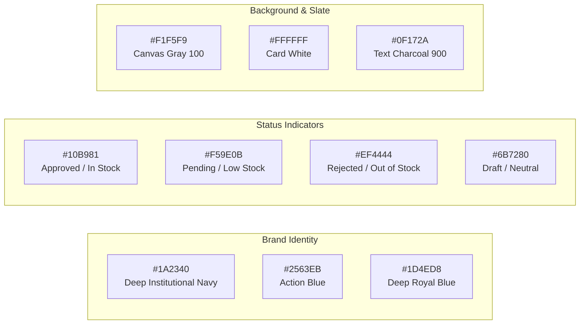
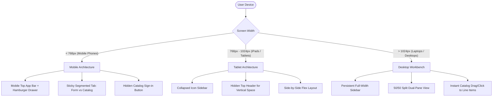

# Design Brief & UI/UX Specifications (DESIGN BRIEF)
## Requisition and Issue Slip (RIS) & Inventory Management Portal

**Document Version:** 1.2.0  
**Design Philosophy:** Institutional Precision & Modern Enterprise Clarity  
**Primary Color Palette:** Deep Navy (`#1A2340`), Vibrant Action Blue (`#2563EB`), Clean Slate (`#F8FAFC`)  
**Target Viewports:** Mobile (`< 768px`), Tablet / iPad (`768px - 1024px`), Desktop / Laptop (`> 1024px`)  
**Last Updated:** October 2026  

---

## 1. Design Philosophy & Aesthetic Intent

Government and administrative software is frequently criticized for obsolete, dense, and confusing user interfaces. The design objective of this system is to bridge **statutory compliance** (adhering strictly to Government Accounting Manual Appendix 63) with **modern SaaS tactile elegance**.

### Core Tenets
1. **Institutional Trust & Authority:** Deep navy framing (`#1A2340`) evokes security, compliance, and permanence.
2. **Zero Ambiguity & High Affordance:** Every interactive element has clear states (hover, focus, active, disabled) with high-contrast text to avoid cognitive friction.
3. **Dual-Panel Ergonomics:** On desktop viewports, the interface pairs the Requisition Form directly with the Live Inventory Catalog side-by-side, eliminating context-switching between tabs.
4. **Adaptive Viewport Intelligence:** Cleanly transforms on mobile devices into a sticky segmented workbench, hiding redundant chrome while maintaining full touch ergonomics.

---

## 2. Color System & Semantic Tokens



### Color Specification Table

| Token Name | Hex Code | Tailwind Utility | Application / Usage |
| :--- | :--- | :--- | :--- |
| **Brand Navy** | `#1A2340` | `bg-[#1A2340]` | Primary desktop header, mobile top app bar, dark accents. |
| **Primary Accent** | `#2563EB` | `bg-blue-600` | Primary action buttons ("Submit RIS", "Approve"), active nav pills. |
| **Accent Hover** | `#1D4ED8` | `hover:bg-blue-700` | Primary button hover state. |
| **Success Emerald** | `#10B981` | `text-emerald-600` | "Approved" status, "In Stock" indicators, positive toasts. |
| **Warning Amber** | `#F59E0B` | `text-amber-600` | "Pending Review" status, "Low Stock" threshold alerts (`< 10 units`). |
| **Danger Rose** | `#EF4444` | `text-red-600` | "Rejected" status, "Out of Stock" badges, destructive actions. |
| **Canvas Neutral** | `#F1F5F9` | `bg-gray-100` | Global application viewport background. |
| **Card Surface** | `#FFFFFF` | `bg-white` | Elevated panels, cards, form inputs, modal dialogs. |
| **Text Primary** | `#0F172A` | `text-slate-900` | Headings, primary labels, table data. |
| **Text Muted** | `#64748B` | `text-slate-500` | Descriptions, metadata, table headers, placeholder text. |

---

## 3. Typography Hierarchy

The interface uses standard system geometric sans-serif typography (`Inter`, `-apple-system`, `BlinkMacSystemFont`, `Segoe UI`, `Roboto`) for optimal legibility across operating systems:

```
Display Header (H1):     24px / 1.5rem   | Bold (700)      | Tracking Tight   | Slate 900
Section Header (H2):     18px / 1.125rem | Semi-Bold (600) | Normal           | Slate 800
Card / Form Header (H3): 15px / 0.938rem | Semi-Bold (600) | Normal           | Slate 800
Body Copy:               14px / 0.875rem | Regular (400)   | Leading Relaxed  | Slate 700
Meta / Badges:           12px / 0.75rem  | Medium (500)    | Uppercase/Normal | Slate 500 / Token
Microcopy / Subtext:     11px / 0.688rem | Regular (400)   | Normal           | Slate 400
```

---

## 4. Viewport Layout & Responsive Architecture

### 4.1 Device-Specific Adaptation Matrix



---

## 5. Screen Wireframes & Layout Schematics

### 5.1 Desktop Dual-Pane Requisition Workbench (`> 1024px`)
```
+----------------------------------------------------------------------------------------------------+
|  [NAV SIDEBAR]   |                        MAIN WORKSPACE (Split 55% / 45%)                         |
|  - Dashboard     |---------------------------------------------------+-----------------------------|
|  - New RIS       |  LEFT: APPENDIX 63 REQUISITION FORM               | RIGHT: INVENTORY CATALOG    |
|  - Admin Inbox   |  [Entity: Apex Innovations Corp] [Fund: FC-01]    | [Search supplies...] [All]  |
|  - Inventory     |  [Division: Technology] [Office: Digital Hub]     | +-------------------------+ |
|  - Reports       |  [Purpose: Operational Workstation Setup       ]  | | STK-1001 Laptop (14)    | |
|  - Archive       |  ------------------------------------------------ | | [Unit] [+ Add to RIS]   | |
|                  |  ITEM DESCRIPTION | STOCK NO | UNIT | QTY | REMARK | +-------------------------+ |
|  [USER PROFILE]  |  1. Laptop 16GB   | STK-1001 | unit |  2  | Deploy | | STK-1004 A4 Paper (110) | |
|  Citizen A       |  2. Precision Mouse| STK-1002| pcs  |  2  | Deploy | | [Ream] [+ Add to RIS]   | |
|  (Project Lead)  |  ------------------------------------------------ | +-------------------------+ |
|  [Sign Out]      |  [+ Add Item Row]          [Submit Official RIS]  | | STK-1002 Mouse (48)     | |
+----------------------------------------------------------------------------------------------------+
```

### 5.2 Mobile Segmented Layout (`< 768px`)
```
+------------------------------------+
| [=] RIS Portal (Appendix 63)   [U] | <-- Mobile App Bar (< 768px only)
+------------------------------------+
| [  Appendix 63 Form  ] [ Catalog ] | <-- Sticky Segmented Switcher
+------------------------------------+
|                                    |
| [Form Tab Active]                  |
| Entity: Apex Innovations Corp      |
| Division: Technology               |
| Purpose: [                       ] |
|                                    |
| Item #1: Workstation Laptop        |
| Qty: [ 2 ]  Stock: 14 available   |
|                                    |
| Item #2: Optical Mouse             |
| Qty: [ 2 ]  Stock: 48 available   |
|                                    |
| [+ Add Another Item]               |
|                                    |
| [===== SUBMIT REQUISITION =====]   |
+------------------------------------+
```

### 5.3 Admin Review & Verification Modal
```
+-----------------------------------------------------------------------------+
|  REVIEW REQUISITION SLIP - CASE #RIS-2026-004                         [ X ] |
+-----------------------------------------------------------------------------+
| Requester: Citizen A (Senior Specialist) | Date: Oct 14, 2026 | Status: PENDING |
| Purpose: Quarterly Field Operations Replacement                             |
+-----------------------------------------------------------------------------+
| STOCK NO | ITEM DESCRIPTION  | QTY REQ | STOCK AVAIL? | QTY ISSUED | REMARKS|
| STK-1001 | Ergonomic Laptop  |    2    | [X]Yes [ ]No |  [  2  ]   | In Whs |
| STK-1004 | Copy Paper A4     |   10    | [X]Yes [ ]No |  [ 10  ]   | In Whs |
+-----------------------------------------------------------------------------+
| Official RIS Number Assignment: [ RIS-2026-004                      ]       |
| Custodian Verification Notes:   [ Verified items in Central Storage ]       |
+-----------------------------------------------------------------------------+
| [ Reject Request (Requires Reason) ]               [ Approve & Issue Items ]|
+-----------------------------------------------------------------------------+
```

---

## 6. Official Appendix 63 Slip Blueprint

The design strictly implements the official geometry of **Appendix 63** of the Government Accounting Manual (GAM):

```
+-----------------------------------------------------------------------------+
|                         REQUISITION AND ISSUE SLIP                          |
|                                                                             |
| Entity Name: __________________________   Fund Cluster: __________________  |
| Division:    __________________________   Responsibility Center: _________  |
| Office:      __________________________   RIS No.: _______________________  |
+-----------------------------------------------------------------------------+
|         REQUISITION                | STOCK AVAILABILITY |       ISSUANCE    |
+----------+------+------------------+--------------------+------+------------+
| Stock No | Unit | Description      | Quantity | Yes | No | Qty  | Remarks    |
+----------+------+------------------+----------+-----+----+------+------------+
| STK-1001 | unit | Workstation Laptop|    2     | [X] | [ ]|  2   | Allocated  |
| STK-1002 | pcs  | Optical Mouse    |    2     | [X] | [ ]|  2   | Allocated  |
+----------+------+------------------+----------+-----+----+------+------------+
| Purpose: Field operations and system monitoring                             |
+-----------------------------------------------------------------------------+
| SIGNATURE SECTION:                                                          |
|                  Requested By:     Approved By:    Issued By:   Received By:|
| Signature:       ______________    _____________   ___________  ___________ |
| Printed Name:    Citizen A         Chief Director  Admin Lead   Citizen A   |
| Designation:     Project Lead      Division Head   Custodian    Project Lead|
| Date:            2026-10-14        2026-10-14      2026-10-14   2026-10-15  |
+-----------------------------------------------------------------------------+
```

---

## 7. Accessibility & Ergonomics Standards

1. **Color Contrast:** All body text meets WCAG 2.1 AA standards (`> 4.5:1` contrast against light background; `> 7:1` against dark navy headers).
2. **Focus Visibility:** Interactive buttons and form inputs utilize visible `focus:ring-2 focus:ring-blue-500` rings for keyboard navigation.
3. **Touch Targets:** All clickable icons and buttons on mobile devices maintain a minimum bounding box of `44px x 44px`.
4. **Zero-Pill Discipline:** Form badges and indicators use crisp rounded rectangles (`rounded-md` / `rounded-lg`) rather than oversized pill capsules, preserving a serious government document feel.
