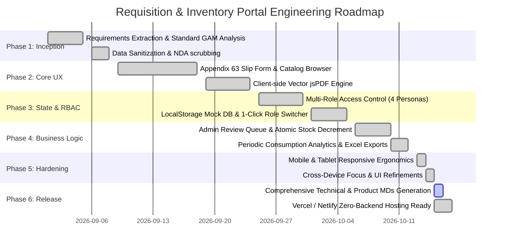
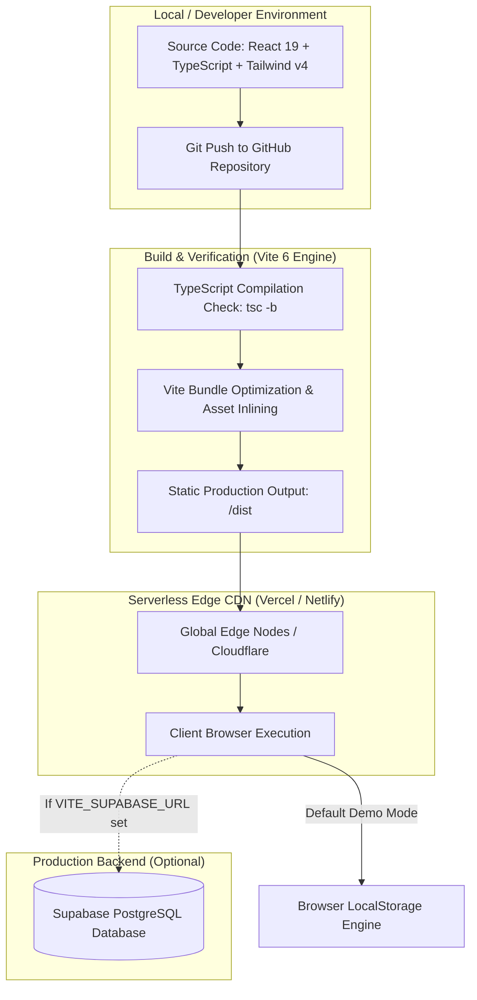
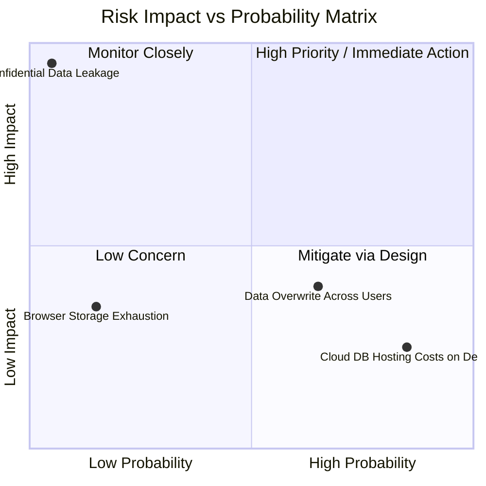

# Implementation Plan & Delivery Roadmap (IMPLEMENTATION PLAN)
## Requisition and Issue Slip (RIS) & Inventory Management Portal

**Document Version:** 1.2.0  
**Project Status:** Production-Ready Demo / Tested & Deployed  
**Deployment Target:** Vercel / Netlify / Cloud Edge Run (Static SPA) + Supabase Connector  
**Last Updated:** October 2026  

---

## 1. Project Phasing & Timeline Gantt Chart

The project follows a structured six-phase engineering lifecycle covering requirements extraction, sanitization, core UI implementation, state persistence, responsive hardening, and production deployment readiness.

---

## 2. Work Breakdown Structure (WBS)

### Phase 1: Requirements Analysis & Data Sanitization
- **WBS 1.1:** Analyze Government Accounting Manual (GAM) Volume II, Appendix 63 requirements.
- **WBS 1.2:** Audit and scrub all production agency data, replacing personnel identifiers with generic test personas (`Citizen A`, `Citizen B`, `Admin Custodian`, `Super Admin`).
- **WBS 1.3:** Formulate sanitized inventory seed catalog covering Equipment and Office Supplies.

### Phase 2: Core Form Builder & Statutory PDF Generation
- **WBS 2.1:** Construct the Appendix 63 Form Builder with dynamic line-item addition/removal.
- **WBS 2.2:** Build live catalog lookup with stock-level badge checks.
- **WBS 2.3:** Implement `pdf.ts` using `jsPDF` and `jsPDF-AutoTable` to render vector-sharp Appendix 63 slips with 4 official signature blocks.

### Phase 3: Authentication, Role-Based Access Control & Dual Storage
- **WBS 3.1:** Implement `AuthContext` with role-based route guards (`/admin-inbox`, `/inventory`, `/reports`, `/superadmin`).
- **WBS 3.2:** Develop `mockApi.ts` client-side storage engine with automatic bootstrapping and factory reset capability.
- **WBS 3.3:** Integrate 1-click credential switcher on the login page for effortless portfolio demonstration.

### Phase 4: Administrative Workflow & Analytics
- **WBS 4.1:** Build Admin Inbox with case review drawer, item verification toggles (`Yes`/`No`), and custom RIS numbering.
- **WBS 4.2:** Implement atomic warehouse stock decrements upon approval.
- **WBS 4.3:** Build `ReportsPage` aggregating Monthly, Quarterly, and Annual supply consumption with `.xlsx` export capabilities.

### Phase 5: Responsive Design & Viewport Refinements
- **WBS 5.1:** Implement mobile layout with sticky segmented tab navigation (`Appendix 63 Form` vs `Inventory Catalog`).
- **WBS 5.2:** Add responsive device conditional visibility: hide redundant top headers and catalog sign-in buttons on tablet/laptop viewports.
- **WBS 5.3:** Optimize touch targets and horizontal scrolling containers for tabular records.

### Phase 6: Documentation & Production Deployment
- **WBS 6.1:** Author comprehensive technical specifications (PRD, TRD, APP FLOW, DESIGN BRIEF, BACKGROUND SCHEMA, IMPLEMENTATION PLAN).
- **WBS 6.2:** Verify clean build compilation (`npm run build`) and zero-error TypeScript linting.
- **WBS 6.3:** Provide turnkey deployment configuration for Vercel and Netlify (`vercel.json`).

---

## 3. Deployment Architecture & CI/CD Pipeline

---

## 4. Quality Assurance & Testing Matrix

| Test Suite / Scope | Test Strategy / Methodology | Expected Outcome | Verification Status |
| :--- | :--- | :--- | :--- |
| **Type Integrity** | Run `tsc --noEmit` across all modules. | Zero compile errors, strict type safety. | **Passed** |
| **Linting & Code Cleanliness** | ESLint validation of hooks, imports, and syntax. | Zero breaking lint errors. | **Passed** |
| **Stock Deduction Engine** | Requisition 2 units of STK-1001 (14 in stock) -> Admin approves -> Check inventory. | Stock decrements to exactly 12; line item reflects approved quantity. | **Verified** |
| **Out-of-Stock Handling** | Requisition item exceeding available balance -> Verify UI warning. | Warning alert renders; custodian modal prompts stock deficit. | **Verified** |
| **Responsive Viewports** | Emulate iPhone 14 (390px), iPad Air (820px), MacBook Pro (1440px). | Clean layout, sticky tabs active on mobile, header hidden on tablet/laptop. | **Verified** |
| **PDF Fidelity Test** | Generate PDF and check 4 signature quadrants, alignment, and page breaks. | Sharp vector rendering strictly adhering to Appendix 63 layout. | **Verified** |
| **1-Click Reset Test** | Modify data -> Click "Reset Data" on login screen. | State restores instantly to default sanitized fixtures. | **Verified** |

---

## 5. Risk Assessment & Mitigation Plan

| Risk Event | Severity | Likelihood | Mitigation Strategy Implemented |
| :--- | :--- | :--- | :--- |
| **Confidential Data Exposure** | Critical | Very Low | Full audit and sanitization: all government names, real assets, and agency references removed. |
| **Demo Failure Due to Database Downtime** | High | Medium | Implemented client-side LocalStorage fallback engine (`mockApi.ts`) enabling 100% serverless evaluation without hosted database fees. |
| **Data Pollution Across Evaluators** | Medium | Medium | Integrated 1-click **Reset Demo Data** button directly on the login screen to restore factory settings at any time. |
| **Mobile Layout Clipping** | Medium | Low | Applied responsive Tailwind v4 classes with device-specific header visibility and segmented touch controls. |
