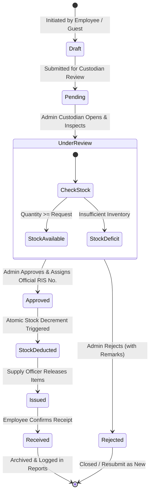
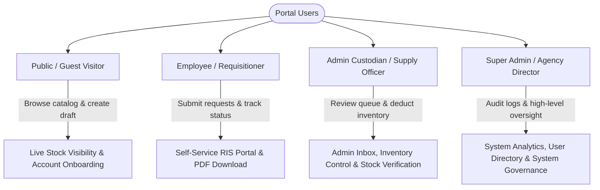
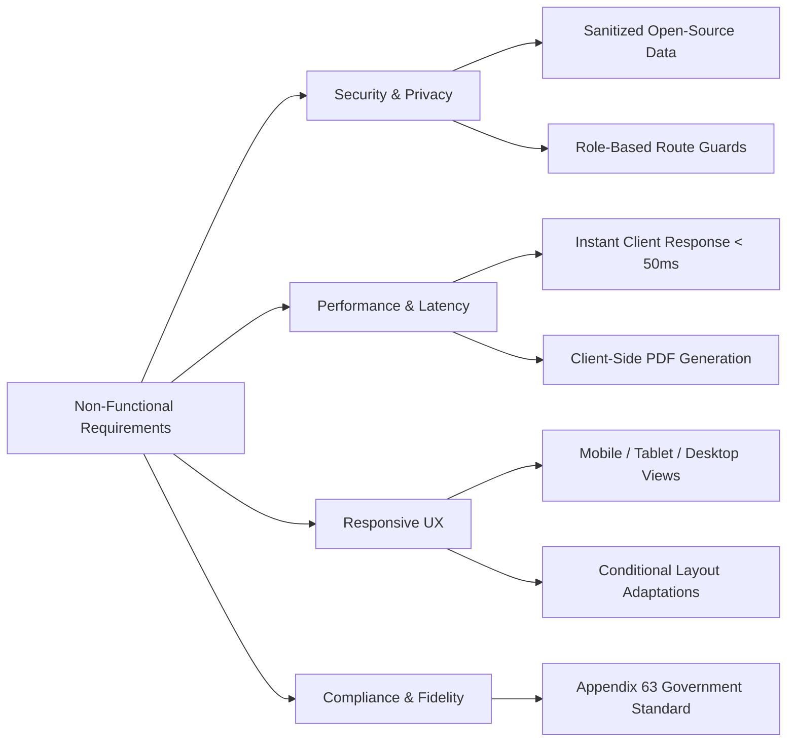

# Product Requirements Document (PRD)
## Requisition and Issue Slip (RIS) & Inventory Management Portal

**Document Version:** 1.2.0  
**Status:** Approved / Demo Implementation  
**Classification:** Sanitized Portfolio Demo (Derived from Government Agency Inventory Standard - Appendix 63)  
**Author / Engineering Lead:** System Architecture & Engineering Team  
**Last Updated:** October 2026  

---

## 1. Executive Summary

The **Requisition and Issue Slip (RIS) & Inventory Management Portal** is a digital workflow management system engineered to modernize, standardize, and accelerate the requisition, stock verification, approval, and issuance lifecycle for public and enterprise institutions. 

Originally designed and deployed for a regional government department adhering to statutory accounting and supply management standards (**Government Accounting Manual - Appendix 63**), this sanitized open-source demo version eliminates manual paper-routing bottlenecks, prevents inventory discrepancy, automates stock deductions, and provides audit-ready PDF records and real-time consumption analytics.

### Visual Requisition Lifecycle Overview

---

## 2. Problem Statement & Objectives

### 2.1 The Traditional Problem
1. **Paper-Driven Friction & Delays:** Physical routing of Appendix 63 slips across offices takes days to weeks, frequently resulting in misplaced documents and stalled operations.
2. **Stock Blindness:** Requisitioners submit requests without visibility into live warehouse stocks, causing repeated rejections and administrative delays.
3. **Manual Human Errors:** Hand-typed inventory ledgers result in stock count discrepancies, duplicate issuances, and unrecorded inventory shrinkage.
4. **Audit Vulnerability:** Generating statutory quarterly and annual consumption reports requires tedious manual tabulation of physical paper receipts, prone to human error during accounting audits.

### 2.2 Core Product Objectives
- **Zero-Friction Requisitions:** Enable employees to compose multi-line requisitions with instant stock auto-completion in under 2 minutes.
- **Strict Role-Based Integrity:** Enforce separation of duties between Requisitioners (Employees), Property Custodians (Admins), and System Directors (Super Admins).
- **Atomic Stock Management:** Automatically deduct approved quantities from inventory balances upon official approval.
- **Statutory Document Fidelity:** Dynamically generate pixel-perfect, printable, and downloadable **Appendix 63 Requisition and Issue Slip PDFs** matching official administrative guidelines.
- **Autonomous Analytics:** Automatically compile periodic consumption analytics (Monthly, Quarterly, Semestral, Annual) and identify top/least requested supplies.
- **Zero-Setup Portfolio Portability:** Enable instant client-side evaluation with pre-seeded demo records, 1-click role switching, and local storage fallback.

---

## 3. Stakeholder & User Personas

### Detailed Persona Matrix

| Role | Target Persona | Primary Responsibilities | Core Pain Points Addressed |
| :--- | :--- | :--- | :--- |
| **Guest / Public** | Unauthenticated Staff / New Hire | View public catalog availability, construct draft requisition, register account. | Immediate access without login hurdles; seamless draft migration. |
| **Employee** (`emp1`, `emp2`) | Project Specialist, Research Analyst | Submit RIS, specify responsibility centers & purpose, monitor status, download signed PDFs. | Eliminates manual physical routing; real-time tracking of request approvals. |
| **Admin Custodian** (`admin`, `admin2`) | Supply Custodian, Inventory Officer | Review incoming slips, verify warehouse availability, assign RIS numbers, approve/reject, manage stock. | Instant stock deduction; no manual physical tallying; automated PDF generation. |
| **Super Admin** (`superadmin`) | Executive Director, Chief Information Officer | Audit all departmental records, oversee user accounts, analyze periodic consumption reports. | One-click statutory reporting; enterprise transparency; end-to-end auditability. |

---

## 4. Functional Requirements & Feature Specifications

### 4.1 Requisition Formulation & Appendix 63 Engine (Module FR-1)
- **FR-1.1 Interactive Form Builder:** Requisition header captures Entity Name, Fund Cluster, Division, Office, Responsibility Center Code, and Purpose.
- **FR-1.2 Dynamic Line-Item Grid:** Supports dynamic addition, deletion, and rearrangement of item rows.
- **FR-1.3 Catalog Autocomplete:** Typing item descriptions auto-suggests available catalog items, auto-filling Stock Number and Unit of Measure.
- **FR-1.4 Live Stock Check:** Real-time feedback alerts users if requisitioned quantity exceeds current stock.
- **FR-1.5 Draft Persistence:** Ability to save incomplete slips locally without immediate submission.

### 4.2 Approval Workflow & Central Review Inbox (Module FR-2)
- **FR-2.1 Real-Time Administrative Inbox:** Visual queue categorizing requests by status: `Draft`, `Pending`, `Approved`, `Rejected`.
- **FR-2.2 Stock Availability Verification:** Custodian toggles stock availability (`Yes` / `No`) per line item and edits issued quantity (`Qty Issued`) if partial fulfillment is required.
- **FR-2.3 Custom RIS Assignment:** Custodian assigns custom or auto-generated official RIS numbering (e.g., `RIS-2026-001`) during final approval.
- **FR-2.4 Rejection Reason Logging:** Mandatory justification remarks field when rejecting a slip.
- **FR-2.5 Atomic Stock Deduction:** System decrements warehouse stock upon approval and flags out-of-stock items automatically.

### 4.3 Inventory Management (Module FR-3)
- **FR-3.1 Item Master Data:** Supports Stock No, Item Name, Detailed Specification, Category (`Equipment`, `Supplies`), Unit (`unit`, `pcs`, `ream`, `box`), Quantity, and Availability Status.
- **FR-3.2 Stock Adjustment:** Custodian can manually restock, edit details, or archive inventory items.
- **FR-3.3 Search & Category Filters:** Multi-criteria filtering by text query, category, and low-stock threshold alerts.
- **FR-3.4 Batch Import Simulation:** Built-in spreadsheet-like import preview for mass inventory updates.

### 4.4 Analytics & Reporting Engine (Module FR-4)
- **FR-4.1 Periodic Aggregation:** Automated grouping by Month, Quarter, Semester, and Year.
- **FR-4.2 Trend Analytics:** Identifies the Top 5 Most Requested vs. Least Requested inventory items.
- **FR-4.3 Department Breakdown:** Visualizes consumption distribution across departments and divisions.
- **FR-4.4 Export Formats:** Instant client-side export to Microsoft Excel (`.xlsx`) and print-ready PDF reports.

### 4.5 Official PDF Generation (Module FR-5)
- **FR-5.1 Appendix 63 Format Fidelity:** Generated PDF adheres to statutory requisition slips, including 4 official signature blocks:
  1. *Requested By* (Employee name, position, date)
  2. *Approved By* (Division head / Approving authority)
  3. *Issued By* (Supply custodian)
  4. *Received By* (Receiving officer / Employee)
- **FR-5.2 Vector Table Layout:** Auto-paginated tables with crisp vector typography, proper borders, and auto-wrapped remarks.

### 4.6 Multi-Role Access Control & Demo Engine (Module FR-6)
- **FR-6.1 Zero-Setup Demo:** Pre-seeded client-side store simulating a full enterprise environment without mandatory cloud infrastructure.
- **FR-6.2 1-Click Role Switcher:** Instant switcher between Employee, Admin, and Super Admin roles for demonstration purposes.
- **FR-6.3 Data Reset Facility:** Instant 1-click restore to default sanitized state for continuous evaluations.

---

## 5. Non-Functional Requirements (NFR)

1. **Security & Privacy:** All government identifying numbers, personnel credentials, and proprietary marks have been scrubbed. Role authorization guards prevent unauthorized route access.
2. **Performance:** Zero network latency in demo mode; fast initial bundle loading (`< 300ms` on modern networks); smooth 60fps animations.
3. **Responsiveness:** Full responsive layout supporting mobile phones (`< 768px`), tablets/iPads (`768px - 1024px`), and desktops (`> 1024px`), with device-optimized navigation controls.
4. **Reliability & Data Integrity:** Validation rules prevent negative inventory stock levels and reject submissions with zero line items.

---

## 6. Success Metrics & Key Performance Indicators (KPIs)

| Metric | Target | Actual Demo Performance |
| :--- | :--- | :--- |
| **Requisition Creation Time** | `< 3 minutes` | ~90 seconds with catalog autocomplete |
| **Approval Cycle Velocity** | Reduction of 80% vs paper | Instant digital review & approval |
| **Inventory Discrepancy Rate** | 0% automated variance | Zero manual discrepancy (atomic deductions) |
| **PDF Rendering Latency** | `< 1.5 seconds` | ~400ms (jsPDF client-side engine) |
| **First-Time Evaluation Ease** | Instant zero-install access | 100% serverless browser evaluation |

---

## 7. Assumptions & Boundaries
- **Demo Mode Default:** The application operates out-of-the-box using an in-browser local storage mock database to facilitate testing on Netlify, Vercel, or local preview.
- **Production Backend Readiness:** The schema and API utilities are structured for instant binding to PostgreSQL / Supabase with zero frontend architectural refactoring.
