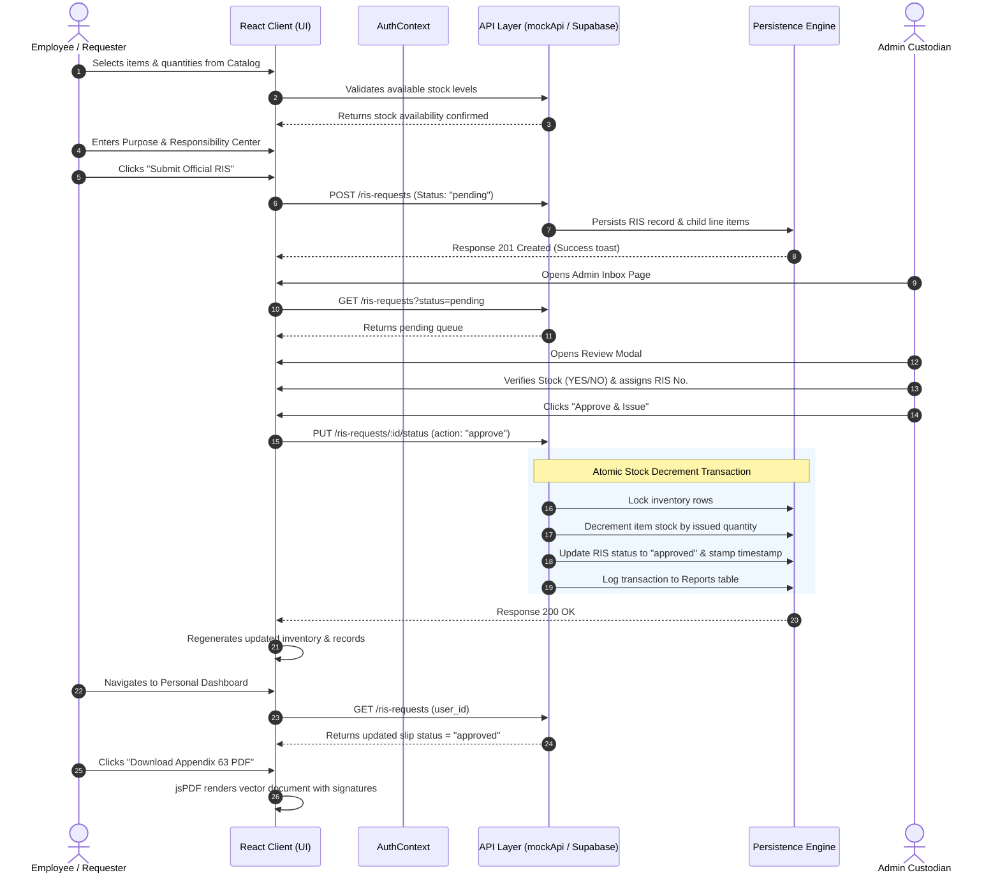
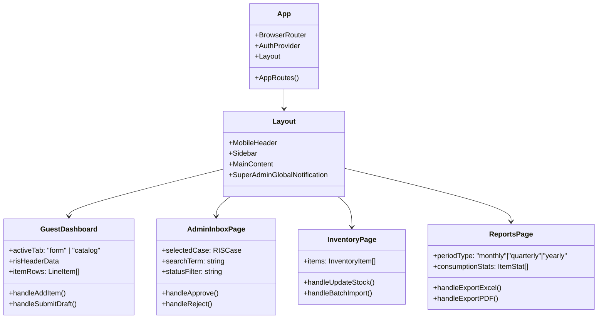

# Technical Requirements Document (TRD)
## Requisition and Issue Slip (RIS) & Inventory Management Portal

**Document Version:** 1.2.0  
**Status:** Implemented & Verified  
**Target Architecture:** Client-Side Single Page Application (SPA) with Dual-Backend Persistence  
**Classification:** Technical Architecture Specification  
**Last Updated:** October 2026  

---

## 1. System Architecture Overview

The RIS & Inventory Management Portal is built as a high-performance **React 19** Single Page Application using **TypeScript** and bundled via **Vite 6**. It features a decoupled, dual-backend architecture: an in-browser local storage mock database engine that delivers zero-latency evaluation for portfolio reviewers, alongside an API abstraction layer with native **PostgreSQL / Supabase** connectors for production deployment.

### 1.1 Layered Architecture Diagram
```mermaid
graph TD
    subgraph ClientLayer ["1. Presentation Layer (React 19 + Tailwind v4)"]
        UI_Guest[Guest & Catalog View]
        UI_Emp[Employee RIS Page]
        UI_Admin[Admin Review Inbox & Inventory]
        UI_Super[Super Admin Analytics & Governance]
        UI_PDF[Appendix 63 jsPDF Generator]
    end

    subgraph StateLayer ["2. Application State & Context Layer"]
        AuthCtx[AuthContext - User Session & Role Guard]
        Router[React Router v7 - Protected Routes]
        Toast[React Hot Toast Notification Dispatcher]
    end

    subgraph ServiceLayer ["3. Service & API Abstraction Layer"]
        API_Switch{API Adapter}
        Mock_Engine[mockApi.ts - In-Browser LocalStorage DB]
        Supabase_Client[supabase.ts - Cloud DB Connector]
        PDF_Engine[pdf.ts - Statutory PDF Builder]
    end

    subgraph DataLayer ["4. Persistence & Storage Layer"]
        LocalStore[LocalStorage: ris_portfolio_demo_db_v2]
        CloudSQL[(PostgreSQL / Supabase Database)]
    end

    ClientLayer --> StateLayer
    StateLayer --> ServiceLayer
    API_Switch -->|Default Demo Mode| Mock_Engine
    API_Switch -->|Production Mode (Env Configured)| Supabase_Client
    Mock_Engine --> LocalStore
    Supabase_Client --> CloudSQL
    UI_PDF --> PDF_Engine
```

---

## 2. Technology Stack & Dependencies

| Layer / Domain | Technology / Package | Version | Purpose / Architectural Rationale |
| :--- | :--- | :--- | :--- |
| **Framework** | [React](https://react.dev/) | `^19.0.0` | Latest React core utilizing modern hooks, concurrent rendering, and clean functional components. |
| **Language** | [TypeScript](https://www.typescriptlang.org/) | `~5.8.0` | Strict compile-time type safety across all database models, API responses, and UI props. |
| **Build Tool** | [Vite](https://vitejs.dev/) | `^6.2.0` | Ultra-fast HMR and optimized tree-shaken static production bundles. |
| **Styling** | [Tailwind CSS](https://tailwindcss.com/) | `^4.0.0` | Modern utility-first CSS using `@import "tailwindcss";` for zero-overhead layout and responsive control. |
| **Icons** | [Lucide React](https://lucide.dev/) | `^1.16.0` | Semantic, lightweight SVG icon system. |
| **Animations** | [Motion](https://motion.dev/) | `^12.4.7` | Fluid micro-interactions, dialog fades, and layout transitions. |
| **Routing** | [React Router](https://reactrouter.com/) | `^7.2.0` | Client-side routing, protected role-based sub-routes, and browser history management. |
| **PDF Generation** | [jsPDF](https://github.com/parallax/jsPDF) & [AutoTable](https://github.com/simonbengtsson/jsPDF-AutoTable) | `^4.2.1` / `^5.0.2` | Native client-side vector PDF generation strictly conforming to Government Appendix 63 layout. |
| **Spreadsheet Engine** | [XLSX (SheetJS)](https://sheetjs.com/) | `^0.18.5` | Exporting inventory ledgers and consumption reports to standard `.xlsx` workbooks. |
| **Notifications** | [React Hot Toast](https://react-hot-toast.com/) | `^2.5.2` | Non-blocking toast feedback for validation, stock warnings, and status changes. |

---

## 3. Directory Structure & Module Breakdown

```
├── /
│   ├── index.html                   # Entry HTML with SEO & OpenGraph meta tags
│   ├── package.json                 # Dependency manifest and scripts
│   ├── tsconfig.json                # TypeScript compilation config
│   ├── vite.config.ts               # Vite configuration with Tailwind plugin
│   ├── database/
│   │   ├── postgres_schema.sql      # Supabase / PostgreSQL DDL and triggers
│   │   ├── mysql_schema.sql         # MySQL / MariaDB compatible schema
│   │   └── fix_schema_cache.sql     # Supabase PostgREST schema cache reloader
│   ├── docs/                        # Complete System Documentation
│   │   ├── PRD.md
│   │   ├── TECHNICAL_REQUIREMENTS.md
│   │   ├── APP_FLOW.md
│   │   ├── DESIGN_BRIEF.md
│   │   ├── BACKGROUND_SCHEMA.md
│   │   └── IMPLEMENTATION_PLAN.md
│   └── src/
│       ├── App.tsx                  # Root routes, Layout shell, and Mobile Header
│       ├── main.tsx                 # React DOM mount point
│       ├── index.css                # Global styles & Tailwind v4 directive
│       ├── components/              # Shared UI components
│       │   ├── Sidebar.tsx          # Responsive navigation sidebar
│       │   ├── RoleSwitcher.tsx     # 1-Click demo role switcher
│       │   ├── SuperAdminGlobalNotification.tsx # System-wide broadcasts
│       │   └── ...                  # Modals, badges, stat cards
│       ├── context/
│       │   └── AuthContext.tsx      # User authentication, role session & logout
│       ├── pages/
│       │   ├── GuestDashboard.tsx   # Public view, catalog search & new RIS builder
│       │   ├── AuthPage.tsx         # Login portal with pre-filled demo role credentials
│       │   ├── EmployeeRISPage.tsx  # Employee personal case tracker & submissions
│       │   ├── AdminInboxPage.tsx   # Custodian inbox, review modal & stock checks
│       │   ├── AdminDashboard.tsx   # Admin supply overview & quick actions
│       │   ├── InventoryPage.tsx    # Inventory ledger, restock & catalog management
│       │   ├── ReportsPage.tsx      # Automated periodic consumption analytics
│       │   ├── ApprovedRISPage.tsx  # Master archive of authorized RIS documents
│       │   └── SuperAdminPage.tsx   # System oversight, user accounts & audit logs
│       └── utils/
│           ├── mockApi.ts           # Browser-based local storage database engine
│           ├── api.ts               # Unified API interface
│           ├── supabase.ts          # Supabase client connector
│           ├── pdf.ts               # Appendix 63 vector PDF generator
│           └── itemIcons.tsx        # Dynamic inventory category icon mapper
```

---

## 4. End-to-End Sequence: Requisition, Review & Atomic Stock Deduction

This sequence diagram illustrates how a requisition moves from formulation through review, stock validation, atomic warehouse deduction, and document archiving:



---

## 5. Component Architecture & Responsibility Matrix

### 5.1 Presentation Layer Components



### 5.2 Key Component Specifications
- **`GuestDashboard.tsx`:** Provides a dual-purpose layout. For public visitors, it serves as an open inventory browser with a guest requisition draft builder. When authenticated, it seamlessly binds the user's Department, Division, and Responsibility Center. Includes responsive tabs for switching between the Appendix 63 Slip Form and the Real-Time Inventory Catalog on mobile/tablet viewports.
- **`AdminInboxPage.tsx`:** Provides an administrative review workstation with filterable status tabs (`All`, `Pending`, `Approved`, `Rejected`), real-time search, interactive review drawer/modal, custom RIS number input, per-item stock availability flags (`Yes`/`No`), and rejection reason logging.
- **`InventoryPage.tsx`:** Full inventory catalog ledger providing real-time stock balances, categories (`Equipment`, `Supplies`), stock-level indicators (`In Stock`, `Low Stock`, `Out of Stock`), manual restock controls, and batch import spreadsheet simulator.
- **`ReportsPage.tsx`:** Aggregates requisition logs into periodic consumption statements (Monthly, Quarterly, Semestral, Annual), highlighting most/least requisitioned items, departmental distribution charts, and one-click `.xlsx` / PDF downloads.
- **`pdf.ts`:** Standalone vector document rendering utility. Implements precise geometry for the Appendix 63 Government Standard: header agency labels, metadata boxes (Entity Name, Fund Cluster, Division, Office, RIS No.), 8-column item matrix, and 4-quadrant official signature section.

---

## 6. API Interface Contracts & Endpoints

The system uses an asynchronous API client interface (`mockApi.ts` / `api.ts`) returning Promise-wrapped standard responses `{ data: T }`.

### 6.1 Authentication Endpoints
- `POST /auth/login`
  - **Payload:** `{ employee_id: string, password_hash: string }`
  - **Success Response:** `{ data: { user: User, token: string } }`
  - **Error Response:** `401 Unauthorized`

### 6.2 Requisition Endpoints (`/ris-requests`)
- `GET /ris-requests`
  - **Query Params:** `status?: string`, `user_id?: number`, `search?: string`
  - **Success Response:** `{ data: RISRequest[] }`
- `POST /ris-requests`
  - **Payload:**
    ```typescript
    {
      entity_name: string;
      fund_cluster: string;
      division: string;
      office: string;
      responsibility_center_code: string;
      purpose: string;
      items: Array<{
        inventory_id: number;
        stock_no: string;
        description: string;
        unit: string;
        quantity_requisition: number;
      }>;
      status: 'draft' | 'pending';
    }
    ```
  - **Success Response:** `201 Created` with full persisted RIS object.
- `PUT /ris-requests/:id/status`
  - **Payload:**
    ```typescript
    {
      status: 'approved' | 'rejected' | 'issued' | 'received';
      ris_no?: string;
      remarks?: string;
      verified_items?: Array<{
        id: number;
        stock_available_yes: boolean;
        stock_available_no: boolean;
        quantity_issue: number;
      }>;
    }
    ```
  - **Side-Effect:** If `status === 'approved'`, atomically decrements `inventory.quantity` for each verified item.

### 6.3 Inventory Endpoints (`/inventory`)
- `GET /inventory`
  - **Query Params:** `category?: string`, `search?: string`, `available_only?: boolean`
  - **Success Response:** `{ data: InventoryItem[] }`
- `PUT /inventory/:id`
  - **Payload:** `Partial<InventoryItem>`
  - **Success Response:** `{ data: InventoryItem }`
- `POST /inventory/batch`
  - **Payload:** `{ items: Array<Omit<InventoryItem, 'id'>> }`
  - **Success Response:** `{ data: { imported_count: number } }`

---

## 7. Storage & State Persistence Architecture

### 7.1 Local Storage Engine Specification
- **Storage Key:** `ris_portfolio_demo_db_v2`
- **Initial Bootstrapping:** If local storage is empty or corrupted, the system seeds 5 default users, 14 categorized inventory items, sample historical requisitions, and analytics logs.
- **Atomic Operations:** All updates to requests, user profiles, or inventory stocks serialize synchronously back to `localStorage` to ensure page refreshes retain state.
- **Factory Reset Hook:** A dedicated `resetData()` utility restores the sanitized baseline seed state instantly.

### 7.2 Database Migration Pathway (PostgreSQL / Supabase)
The schema defined in `/database/postgres_schema.sql` mirrors the local storage schema identically:
- BigInt primary keys with auto-incrementing identity (convertible to UUIDv4).
- Foreign key cascading deletes on `ris_items` when a parent `ris_requests` row is removed.
- `update_modified_column()` PL/pgSQL trigger function updating `updated_at` timestamps on row mutation.

---

## 8. Non-Functional & Quality Attributes

### 8.1 Performance Targets
- **Lighthouse Performance Score:** `> 90`
- **First Contentful Paint (FCP):** `< 0.8s`
- **Time to Interactive (TTI):** `< 1.2s`
- **Client-Side Storage Footprint:** `< 2.5 MB` total footprint for 500+ records in `localStorage`.

### 8.2 Browser & Device Compatibility
- Modern Evergreen Browsers: Chrome 115+, Edge 115+, Safari 16.4+, Firefox 115+.
- Fully adaptive across screen widths from 360px (mobile) to 4K displays.
- Touch gesture support on mobile drawers and responsive tables with horizontal scroll wrappers.
